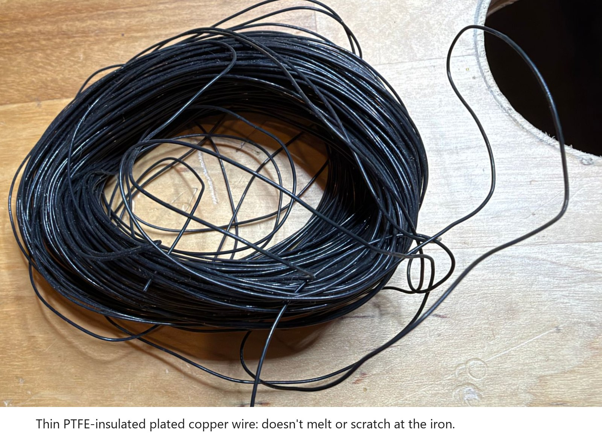
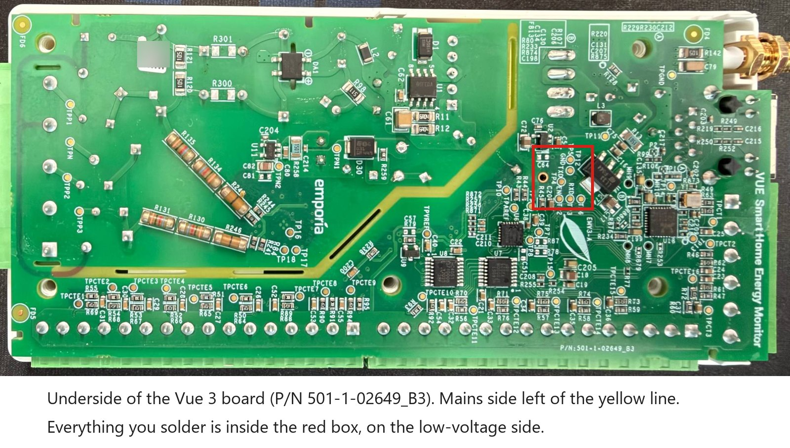
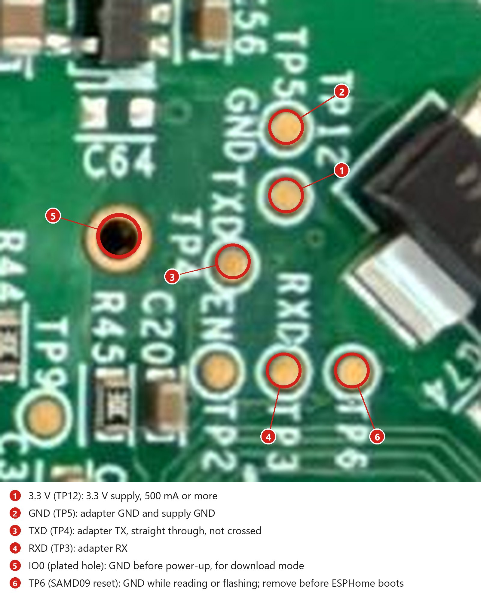
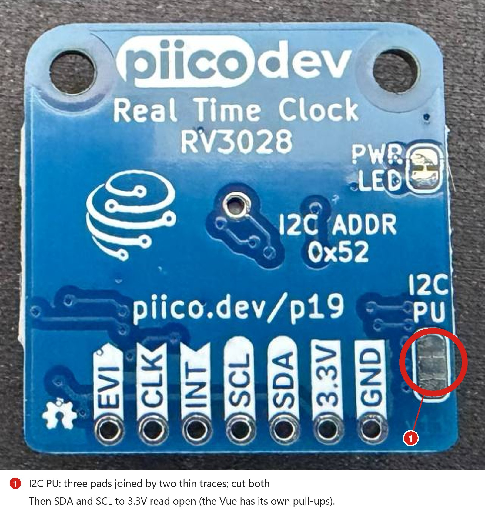
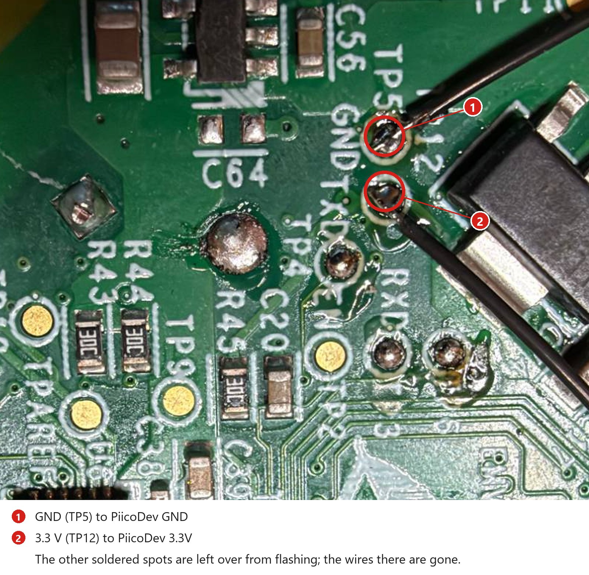
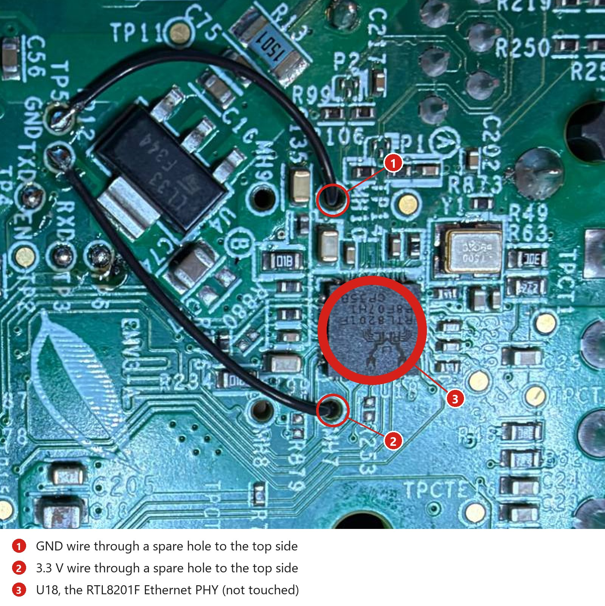
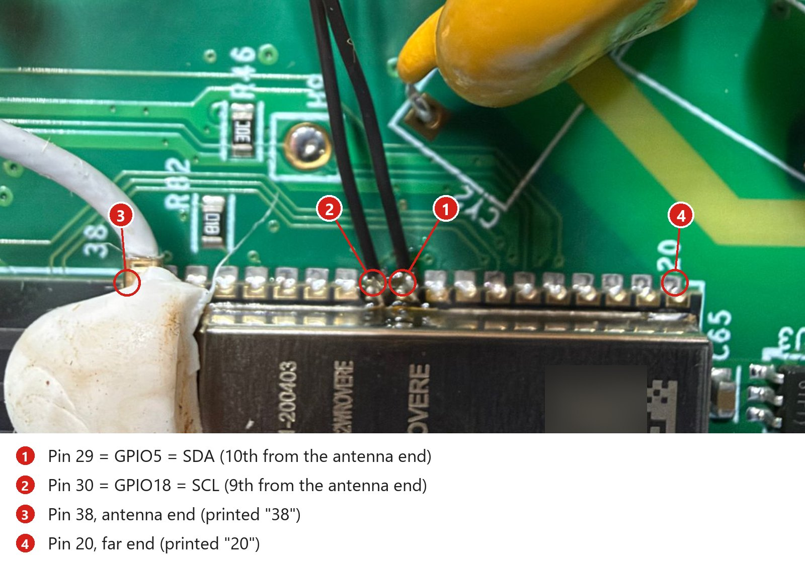
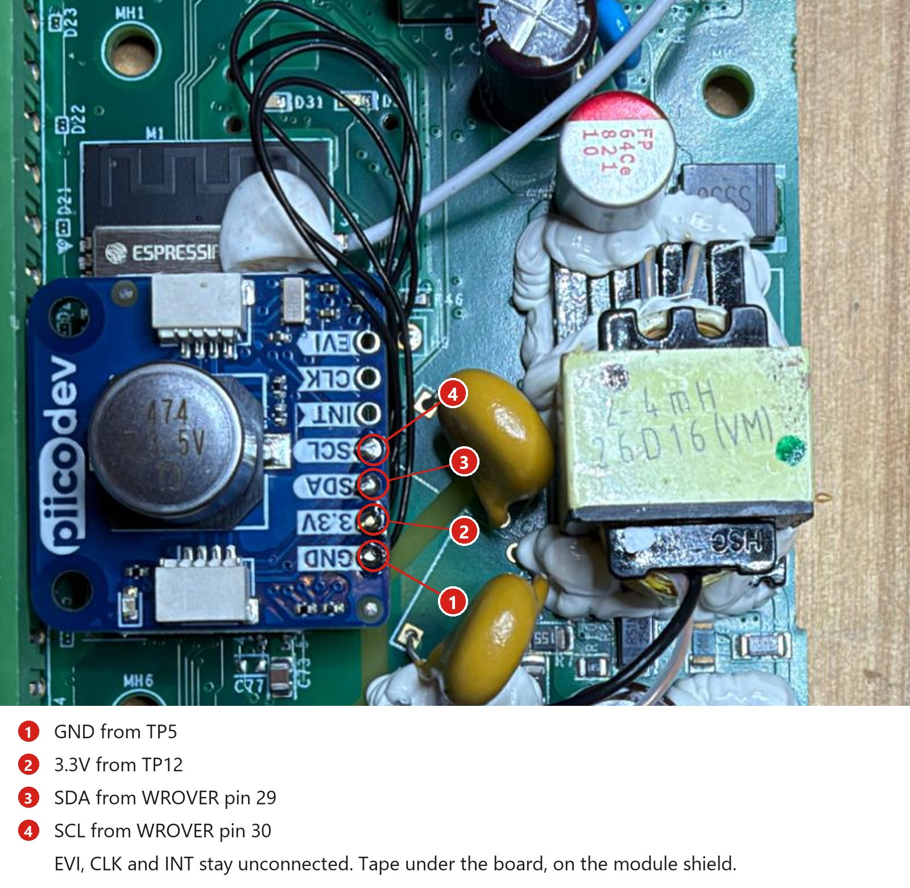
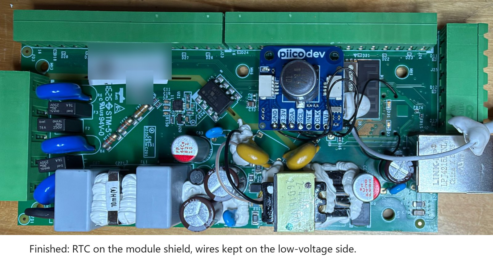

# Emporia Vue 3: backup, first flash and the RTC

This is how the first unit was converted in November 2026: board P/N
501-1-02649_B3, ESP32-WROVER-IE, 8 MB flash. The photos are of that board.

Work on the board only with mains disconnected. Never have a serial adapter or
bench supply connected while the Vue is on mains. Everything below is on the
low-voltage side of the yellow isolation line.

## What you need

- A 3.3 V USB-serial adapter. A CH340G board with a 3V3/5V jumper set to 3V3
  worked.
- A separate 3.3 V supply that can deliver 500 mA. An ESP32-C3 Super Mini
  worked: its 3V3 pin to the Vue, held in BOOT while plugging it in so its own
  chip stays quiet. The adapter's 3.3 V pin alone was not enough.
- esptool, which comes with ESPHome (`pip install esphome`).
- For the RTC: a [PiicoDev RV-3028](https://core-electronics.com.au/piicodev-real-time-clock-rv3028.html),
  thin wire and tape.



The wire used here is thin PTFE-insulated plated copper. PTFE doesn't melt at
the iron and doesn't scratch through, which matters on a crowded board; it is
hard to strip. Today's equivalent is 30 AWG PTFE hook-up wire (silver-plated
copper, M22759 or MIL-W-16878). Kynar wire-wrap wire is the cheaper second
choice.

## 1. Open the case and find the pads

Remove the screws on the back and lift the board out. The serial pads are on the underside of the board,
in the red box:



## 2. Wire up for flashing



The TXD and RXD labels are from the adapter's side, so TX goes to TX and RX
to RX. IO0 is the plated hole; tie it to GND before power-up for download
mode.

TP6 is the SAMD09's reset. Tie it to GND too. With the stock SAMD09 firmware
running, reads over the serial line got single flipped bits every 20-90 KB
and esptool's stub never answered. With TP6 held low, the full 8 MB read
passed every block checksum first time. Remove the TP6 wire before ESPHome
boots: the firmware drives that line from GPIO23.

Power-up order: adapter in, then the 3.3 V supply.

## 3. Back up the stock firmware

```powershell
esptool --chip esp32 -p COM5 flash-id
esptool --chip esp32 -p COM5 read-flash 0 ALL vue3-stock-1.bin
esptool --chip esp32 -p COM5 read-flash 0 ALL vue3-stock-2.bin
Get-FileHash vue3-stock-*.bin
```

`flash-id` should report 8MB. The two hashes must match. The image holds your
Wi-Fi credentials and the unit's Emporia identity: keep it private.
`write-flash 0 vue3-stock-1.bin` restores the stock firmware.

There is no per-unit calibration to recover from it; calibrate voltage and CT
gain against a meter after installation.

## 4. Flash ESPHome

WattLedger adds its own partition, which OTA can't create, so the first
install goes over serial. In the ESPHome dashboard: Install, Manual download,
Factory format. Then:

```powershell
esptool --chip esp32 -p COM5 write-flash --erase-all 0x0 emporia-vue-grid.factory.bin
```

Power off, remove the IO0 and TP6 wires, power on. From here on updates go
over OTA, including adding Ethernet (`packages/vue3-ethernet.yaml`).

## 5. RTC (optional)

The RV-3028 shares the I2C bus the ESP32 already uses for the SAMD09
(0x64); it answers at 0x52.

| PiicoDev | Vue 3 |
|---|---|
| GND | TP5 (underside) |
| 3.3V | TP12 (underside) |
| SDA | ESP32-WROVER-IE pin 29 (GPIO5) |
| SCL | ESP32-WROVER-IE pin 30 (GPIO18) |
| EVI, CLK, INT | not connected |

### 5.1 Prepare the PiicoDev

Cut both traces of the three-pad I2C PU jumper: the Vue has its own pull-ups.
Afterwards SDA and SCL read open to 3.3V. Taking the JST connectors off saves
height but isn't required.



### 5.2 Power from the flashing pads



The power wires go through spare holes to the top side. U18 next to them is
the Ethernet PHY; leave it alone.



### 5.3 SDA and SCL on the module

The bus has no test point (TP9 and TP10 are other signals), so solder to the
module's castellations. The WROVER has 19 pins on each long side: 1-19 along
the terminal-block edge starting at the antenna end, 20-38 back along the
transformer edge. Pins 29 and 30 are the 10th and 9th from the antenna end on
the transformer edge. Each reads about 4.7 kOhm to 3.3 V through the bus
pull-up.



The SAMD09 (U6, underside) is a QFN with nothing to solder to; its ends of
the bus are PA22 (SDA) and PA23 (SCL).

### 5.4 Mount and wire the board

The PiicoDev sits on tape over the module's metal shield. The WROVER-IE has
no PCB antenna (it uses the IPEX lead to the SMA socket), so covering it
doesn't affect Wi-Fi. Keep the wires on the low-voltage side, away from the
transformer and the Y-capacitors CY1/CY2, and secure them before closing the
lid.





### 5.5 Test it

Add [packages/vue3-rtc.yaml](../packages/vue3-rtc.yaml) to the node.

- The boot log no longer says `rv3028.time is marked FAILED`.
- A software restart proves nothing: the ESP32 keeps its clock through a
  reset. Cut the power.
- The 0.47 F supercapacitor charges through the RV-3028's 3 kOhm trickle
  resistor, a time constant of about 23 minutes. After 17 minutes of charge
  the time didn't survive a power cut; after 45 minutes it did. A full charge
  holds about a week.
- `http://<device>/wattledger/v1/rows?tier=events` shows the result. Rows are
  `[seq, type, boot, seconds_since_boot, unix_time, a, b]`. The ANCHOR (type
  2) of a cold boot comes at 0 s when the RTC supplied the time, and 4 s or
  more when it came from SNTP or Home Assistant.
